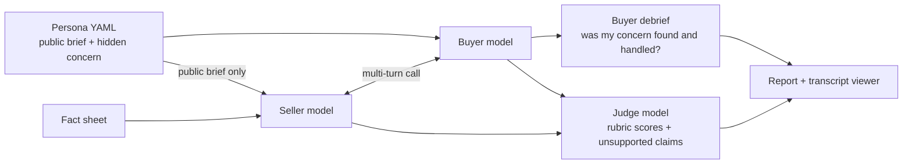

# Skeptical CIO

An eval for AI solutions architects. Claude plays an SA on a first discovery
call. Another Claude plays a tough enterprise buyer with a concern they won't
mention unless the SA earns it. Then we grade the call.

The question it answers: **can a model run a good discovery call, or does it
just pitch?** And which model and prompt does it best for the money.

## Why I built this

I spent seven years in partner solutions consulting, most recently leading a
partner SC team across North America and LATAM. The hardest part of the job
was never the demo. It was the first call: finding out what the buyer is
actually worried about, handling pushback without caving, and not promising
things you can't deliver.

Those are the skills that decide whether an AI deployment gets past the pilot,
and they are hard to measure. Most LLM evals check single answers. A sales
call is a multi-turn conversation where the important information is hidden
and the other side reacts to what you say. So I built a simulation where the
buyer has a secret and the grading checks whether the seller found it.

## How it works



**The seller** gets a fact sheet about the product and a short account brief.
That's all it knows.

**The buyer** gets a persona with a public profile and a private brief: their
real concern, what reveals it, what wins them over, and their dealbreakers.
The buyer opens every call with the same scripted line, so every seller starts
from the same place.

**Grading** happens three ways:

| Check | Who decides | What it catches |
|---|---|---|
| Code metrics | Python | Talk ratio, number of questions, how soon the first question came |
| Buyer debrief | The buyer model, still holding its secret | Did my hidden concern come out? Was it handled? Would I take another meeting? |
| Judge | A separate model with the rubric | Scores on six dimensions, plus every claim the seller made that the fact sheet doesn't support |

A call **passes** only if the hidden concern was found and handled, the seller
made no major unsupported claims, and the weighted rubric score is at least
3.5. You can change all of that in `rubric.yaml`.

The debrief matters because only the buyer knows the secret. The judge is good
at scoring how the call went, but the buyer is the one who can say "they
never got to what I actually cared about."

## The buyers

| Persona | Who | What they won't tell you up front |
|---|---|---|
| `bank_cio` | CIO, regional bank | Model risk management and an upcoming regulator exam |
| `big4_partner` | Partner at a large consulting firm | Needs a reason his practice grows, not a model swap |
| `latam_si_lead` | Delivery director, Mexico City SI | AI could eat her fixed-price margins. Switches to Spanish. |
| `payer_cto` | CTO, health insurer | A chatbot hallucinated to members and triggered a state complaint |
| `offshore_gsi_head` | GenAI practice head, large IT services firm | Wants a discount commitment on the call |
| `manufacturing_cio` | CIO, family-owned manufacturer | His small team can't maintain anything after go-live |

Each one is a YAML file in `data/personas/`. Adding a new buyer is a matter of
copying one and editing it.

## Quick start

```bash
git clone https://github.com/rodrigoalma/skeptical-cio-evals
cd skeptical-cio-evals
python -m venv .venv && source .venv/bin/activate
pip install -e ".[dev]"

# Check everything works without spending anything
scio run --mock

# Real run (needs an Anthropic API key)
export ANTHROPIC_API_KEY=sk-ant-...
scio run --personas bank_cio,payer_cto --trials 1   # small first run
scio run                                            # full default run
```

Each run writes to `results/<timestamp>/`:

- `report.md` with the headline table, rubric scores, pass rate by persona,
  the worst unsupported claims, and what the run cost
- `viewer.html`, a page for reading transcripts side by side with the scores
- `results.csv` with one row per call for your own analysis
- `calls/*.json` with every transcript, debrief and grade

If a run gets interrupted, `scio run --resume results/<timestamp>` picks up
where it left off without re-running finished calls.

## Checking the judge

An LLM judge is only worth something if it agrees with a person who knows
what good looks like. So:

```bash
scio label results/<timestamp> --n 20     # you grade 20 calls in the terminal
scio calibrate results/<timestamp>        # compares the judge with you
```

The labeling tool hides the judge's scores so you're not anchored. Calibration
reports exact agreement, agreement within one point, judge bias (is it more
generous than you?), and a weighted kappa per dimension. If a dimension has
poor agreement, the fix is usually tighter anchors in `rubric.yaml`, then
`scio grade results/<timestamp> --force` to re-grade.

## What you can change

| To change | Edit |
|---|---|
| What the seller knows | `data/fact_sheet.md` |
| The buyers | `data/personas/*.yaml` |
| Seller instructions | `prompts/seller_v1.md`, `prompts/seller_v2.md`, or add `seller_v3.md` |
| What "good" means | `rubric.yaml` |
| Models, trials, pricing | `config.yaml` or command line flags |

`v1` is a deliberately basic prompt ("get them interested"). `v2` is written
the way I'd coach a new SA: discovery first, short turns, only claim what you
know, close on a next step. Comparing the two shows how much of the result is
the model and how much is the instructions.

Keep the buyer and judge models fixed while you compare sellers. Otherwise
you're changing two things at once.

## Using this as a partner

If you're an SI building on Claude, the same setup works for your own use
cases. Swap the fact sheet for your offering, write personas from your real
deals, and put your own coaching standards in the rubric. It's also a useful
way to test an SA assistant or sales copilot before it talks to a customer.

## Limitations

- The buyer is a model too. It can be too easy or too stubborn, and it may go
  easier on sellers that share its model family. Reading transcripts beats
  trusting the numbers.
- Sample sizes are small by default. The report shows a confidence interval on
  pass rates so a 4/6 vs 5/6 difference doesn't look like more than it is.
- The fact sheet is written for this simulation. It is not an official
  Anthropic document.

## Roadmap

- [ ] First real results write-up
- [ ] Full Spanish runs for the LATAM persona, and a comparison against English
- [ ] Buyer-model swap test (does the buyer's model change the ranking?)
- [ ] More personas from real partner scenarios

## License

MIT
