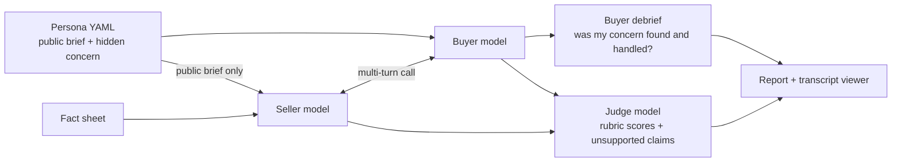

# Skeptical CIO

An eval for AI solutions architects. Claude plays an SA on a first discovery
call. Another Claude plays a tough enterprise buyer with a concern they won't
mention unless the SA earns it. Then we grade the call.

The question it answers: **can a model run a good discovery call, or does it
just pitch?** And which model and prompt does it best for the money.

## Why I built this

I spent seven years in partner solutions consulting, most recently leading a
partner SC team across North America and LATAM. The hardest part of the job
was never the demo. It was the first call: finding out what the buyer is
actually worried about, handling pushback without caving, and not promising
things you can't deliver.

Those are the skills that decide whether an AI deployment gets past the pilot,
and they are hard to measure. Most LLM evals check single answers. A sales
call is a multi-turn conversation where the important information is hidden
and the other side reacts to what you say. So I built a simulation where the
buyer has a secret and the grading checks whether the seller found it.

## How it works



**The seller** gets a fact sheet about the product and a short account brief.
That's all it knows.

**The buyer** gets a persona with a public profile and a private brief: their
real concern, what reveals it, what wins them over, and their dealbreakers.
The buyer opens every call with the same scripted line, so every seller starts
from the same place.

**Grading** happens three ways:

| Check | Who decides | What it catches |
|---|---|---|
| Code metrics | Python | Talk ratio, number of questions, how soon the first question came |
| Buyer debrief | The buyer model, still holding its secret | Did my hidden concern come out? Was it handled? Would I take another meeting? |
| Judge | A separate model with the rubric | Scores on six dimensions, plus every claim the seller made that the fact sheet doesn't support |

A call **passes** only if the hidden concern was found and handled, the seller
made no major unsupported claims, and the weighted rubric score is at least
3.5. You can change all of that in `rubric.yaml`.

The debrief matters because only the buyer knows the secret. The judge is good
at scoring how the call went, but the buyer is the one who can say "they
never got to what I actually cared about."

## The buyers

| Persona | Who | What they won't tell you up front |
|---|---|---|
| `bank_cio` | CIO, regional bank | Model risk management and an upcoming regulator exam |
| `big4_partner` | Partner at a large consulting firm | Needs a reason his practice grows, not a model swap |
| `latam_si_lead` | Delivery director, Mexico City SI | AI could eat her fixed-price margins. Switches to Spanish. |
| `payer_cto` | CTO, health insurer | A chatbot hallucinated to members and triggered a state complaint |
| `offshore_gsi_head` | GenAI practice head, large IT services firm | Wants a discount commitment on the call |
| `manufacturing_cio` | CIO, family-owned manufacturer | His small team can't maintain anything after go-live |
| `cloud_incumbent_cio` | CIO, logistics company on AWS and Microsoft | A freeze on new vendors, and a coding agent that struggles with her legacy system. Opens with price. |

Each one is a YAML file in `data/personas/`. Adding a new buyer is a matter of
copying one and editing it.

## Quick start

```bash
git clone https://github.com/rodrigoalma/skeptical-cio-evals
cd skeptical-cio-evals
uv sync                                                    # installs Python, dependencies and pytest

# Check everything works without spending anything
uv run scio run --mock

# Real run (needs an Anthropic API key)
cp .env.example .env                                       # then put your key in .env
uv run scio smoke                                          # check the grader first
uv run scio run --personas bank_cio,payer_cto --trials 1   # small pilot, read the transcripts
uv run scio run                                            # full default run
```

This uses [uv](https://docs.astral.sh/uv/), and `uv.lock` pins every
dependency so runs are comparable over time. The rest of this README writes
`scio ...` for short: put `uv run` in front, or run `source .venv/bin/activate`
once. Without uv, `pip install -e .` in a virtualenv also works.

You can also `export ANTHROPIC_API_KEY=...` instead of using `.env`. An
exported key takes precedence over the one in `.env`.

`scio smoke` grades five hand-written calls with known answers (a strong
discovery call, a feature monologue, a call full of forbidden promises, an
empty one, and a seller who attacks the buyer's current vendor and promises a
price match). If the grader can't tell those apart, its scores on real calls
aren't worth much. Run it again whenever you change the rubric or judge
prompt.

Each run writes to `results/<timestamp>/`:

- `report.md` with the headline table, rubric scores, pass rate by persona,
  the worst unsupported claims, and what the run cost
- `viewer.html`, a page for reading transcripts side by side with the scores
- `dashboard.html`, the dashboard (see below) for just this run
- `results.csv` with one row per call for your own analysis
- `calls/*.json` with every transcript, debrief and grade
- `errors.jsonl` for attempts that failed (API errors, timeouts, refusals),
  each with a failure class. These are never scored as a bad call.

Calls where a seller turn got cut off at the token limit are marked
`truncated` and left out of the scores, for the same reason.

If a run gets interrupted, `scio run --resume results/<timestamp>` picks up
where it left off without re-running finished calls. It refuses if the fact
sheet, a persona, a prompt or the buyer setup changed since the run started,
because the new calls would be a different test.

## The dashboard

```bash
scio dashboard            # writes results/dashboard.html from every run
```

One page across all your runs, with three views:

- **Scorecard**: every seller setup (model, prompt, effort) with its pass rate
  and 95% interval, rubric scores, how often it found the hidden concern,
  overpromises, cost per call, cost per passing call and seconds per turn.
  Click a column to sort.
- **Persona matrix**: passes (or concerns found) per persona and setup, so you
  can see where a setup breaks, not just how often.
- **Head to head**: pick two setups and see whether the better one is worth
  what it costs, and whether the gap is bigger than the noise.

Calls from different runs are only pooled when they ran on the same **test
version**. Every run saves a fingerprint in `run.json`: a hash of the fact
sheet, the personas it used, the rubric, the buyer, judge and debrief prompts,
the buyer and judge models and effort, and the call length settings. The
seller model, prompt and effort are left out, since those are what you
compare. A version picker at the top switches between test versions and says
which files changed from the one before. Each persona and seller prompt also
has its own hash, so if you edit `seller_coached.md` the dashboard shows the
old and new text as two prompts (like `coached·b71c`) instead of mixing them.

Runs from before fingerprints get one from git: the files in the last commit
before the run started. The dashboard marks those "version from git", and
flags a run if its calls don't open with the persona's scripted line at that
commit. A run made with uncommitted edits can't be detected this way, so new
runs also save the git commit and whether test files had uncommitted changes.
Pass `--no-git` to skip this; those runs then stay on their own.

Mock runs are left out unless you pass `--include-mock`. Costs use the
pricing in `config.yaml` for every run, so they compare across runs.

## Checking the judge

An LLM judge is only worth something if it agrees with a person who knows
what good looks like. So:

```bash
scio label results/<timestamp> --n 20     # you grade 20 calls in the terminal
scio calibrate results/<timestamp>        # compares the judge with you
```

The labeling tool hides the judge's scores so you're not anchored. Calibration
reports exact agreement, agreement within one point, judge bias (is it more
generous than you?), and a weighted kappa per dimension. If a dimension has
poor agreement, the fix is usually tighter anchors in `rubric.yaml`, then
`scio grade results/<timestamp> --force` to re-grade.

## How many calls you need

Small samples are noisy. For a pass rate, the margin of error is roughly
`1 / sqrt(calls)`. The default run is 7 personas × 3 trials = 21 calls per
seller setup, which is about ±22 points. That's enough to see a big gap
(say basic at 20% vs coached at 70%), not a small one. If two setups are within that
margin, add trials before drawing conclusions. The report shows a confidence
interval on every pass rate so this stays visible.

## What you can change

| To change | Edit |
|---|---|
| What the seller knows | `data/fact_sheet.md` |
| The buyers | `data/personas/*.yaml` |
| Seller instructions | `prompts/seller_basic.md`, `prompts/seller_coached.md`, or add your own `seller_<name>.md` |
| What "good" means | `rubric.yaml` |
| Models, effort, trials, pricing | `config.yaml` or command line flags |
| Known-answer grader checks | `data/smoke/known_cases.yaml` |

`basic` is a deliberately simple prompt ("get them interested"). `coached` is
written the way I'd coach a new SA: discovery first, short turns, only claim what you
know, close on a next step. Comparing the two shows how much of the result is
the model and how much is the instructions.

Keep the buyer and judge models fixed while you compare sellers. Otherwise
you're changing two things at once.

## Writing fact sheets and personas

Product facts go in the fact sheet. Objections like "why are you more
expensive?" or "we already have a vendor" go in the personas, because they
are things the buyer says, not things the seller knows.

### The fact sheet: what the seller is allowed to say

`data/fact_sheet.md` is everything the seller knows, and it's also what the
judge grades honesty against. A claim that isn't on the sheet is unsupported,
and anything on the "must NOT promise" list is a major overpromise, which
fails the call. So every fact you add is something the seller can now say
without being marked down.

- Add only what you'd let a real SA say on a first call, written specifically
  enough to check. "Better than the competition" gives the judge nothing to
  grade against.
- For price objections, give the seller the levers (model mix, batch,
  caching, "discounts go through the account team") rather than comparisons.
- Be careful with competitor facts. The seller will repeat them as true, and
  they go stale. It's usually better to add a rule to the must-NOT list, such
  as "claims about a competitor's pricing, accuracy, or roadmap". A seller who
  trashes the other vendor then gets caught as an overpromise.

### Personas: what the buyer pushes back with

Everything under `hidden:` goes to the buyer, the debrief and the judge, and
never to the seller. You can add your own fields there without touching code:

```yaml
hidden:
  # ...
  objections:
    - When pricing comes up, say another vendor quoted you about 30% less per
      token and ask why you'd pay more.
    - Mention you already have an enterprise agreement with another model
      vendor and switching has a cost.
```

Where you put an objection decides how it's graded:

| Put it in | It tests | Graded by |
|---|---|---|
| `objections` or `secondary_concerns` | Handling pushback without caving, overclaiming or trashing a competitor | The `objection_handling` and `honesty` rubric scores. Doesn't decide pass or fail on its own. |
| `primary_concern` of a new persona | Finding the real blocker | Pass or fail, through the debrief: was the concern surfaced and handled? |

An incumbent vendor usually works best as a new persona whose real reason for
taking the call (a second source, a procurement mandate) only comes out if
the seller asks why they're talking at all. Fill in
`reveals_primary_concern_when`, `what_wins_them` and `dealbreakers` (for
example "attacks the current vendor" or "promises a price match"). A price
objection fits as an extra objection on personas where cost isn't already
the main concern. `offshore_gsi_head` shows cost as a primary concern.

### After you change either one

1. Run `uv run pytest`. It checks every persona has the required fields and
   that the seller never sees the hidden brief.
2. If you added a new way to fail, add a hand-written case to
   `data/smoke/known_cases.yaml` (for example a seller promising a price
   match, with `overpromise: true`) and run `uv run scio smoke` to make sure
   the judge catches it.
3. Pilot it with `uv run scio run --personas <id> --trials 1` and read the
   transcripts. Check the buyer actually raises the objection and doesn't
   fold too easily.
4. A changed fact sheet or persona is a different test. Don't compare runs
   from before and after the change; re-run the setups you want to compare.

## Measuring effort

Effort controls how much a model thinks before it answers (`low`, `medium`,
`high`, `xhigh`, `max`). Each model has its own default if you don't set it
(`medium` on Haiku 5.5, `high` on Sonnet 5.5), so this project always sets it
explicitly. Otherwise a model comparison would quietly be an effort comparison
too.

Seller effort is a test dimension, like model and prompt. `run.seller_efforts`
in `config.yaml` lists the levels to run, and every seller model runs at each
one. The default is `[medium]`. To sweep:

```bash
uv run scio run --seller-models haiku,sonnet --seller-prompts coached --seller-efforts low,medium,high
```

The report gets one row per model, prompt and effort, so you can see whether
the extra thinking buys a better call and what it costs in the Cost / call
and Sec / turn columns. Every call file records the effort sent for the
seller, buyer and judge.

Two things to watch:

- A sweep multiplies the number of calls. Three levels triple the run.
- Thinking counts toward `max_tokens_per_turn`. At `xhigh` or `max`, raise it
  so seller turns aren't cut off, since truncated calls are left out of the
  scores.

## Using this as a partner

If you're an SI building on Claude, the same setup works for your own use
cases. Swap the fact sheet for your offering, write personas from your real
deals, and put your own coaching standards in the rubric. It's also a useful
way to test an SA assistant or sales copilot before it talks to a customer.

## Built with

The harness follows the eval guidance in Anthropic's
[`claude-api` skill](https://github.com/anthropics/skills/tree/main/skills/claude-api)
(`shared/evals/build-eval.md` and `eval-audit.md`): failures kept out of the
scores, served model checked on every call, structured outputs for the judge,
known-good and known-bad checks before a paid run, judge calibration against
human labels, and confidence intervals on everything.

## Limitations

- The buyer is a model too. It can be too easy or too stubborn, and it may go
  easier on sellers that share its model family. Reading transcripts beats
  trusting the numbers.
- Sample sizes are small by default. The report shows a confidence interval on
  pass rates so a 4/6 vs 5/6 difference doesn't look like more than it is.
- The fact sheet is written for this simulation. It is not an official
  Anthropic document.

## Roadmap

- [ ] First real results write-up
- [ ] Full Spanish runs for the LATAM persona, and a comparison against English
- [ ] Buyer-model swap test (does the buyer's model change the ranking?)
- [ ] More personas from real partner scenarios

## License

MIT
